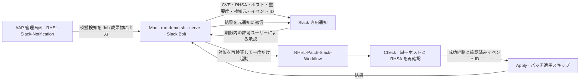

# RHEL Patch Demo の構成

OpenTLC の AAP が RHEL の RHSA 確認と Workflow を実行し、Mac の Slack Bolt が Slack の承認操作を AAP に伝えます。デモ運用で確認済みの構成は Automation Controller 4.5.30 と従来型 `/api/v2/` です。ツールは AAP 2.5／2.6 の Gateway API も判定します。

復元ツールは、手動デモ用の `RHEL-Patch-Workflow`（Check → AAP Approval → Apply）と、統合用の `RHEL-Patch-Slack-Workflow`（Check → Apply）を別々に作成します。既存の手動 Workflow の設定を変更しません。統合デモの入口は `RHEL-Slack-Notification`、手動デモの待ち受けは `start-slack-demo.sh` です。

統合デモでは設定の単一ホストと RHSA を固定し、Slack のボタン値は通知とイベント ID の照合にだけ使います。承認者、期限、通知先をイベント記録に紐づけます。AAP 用の変数は記録済みイベントから組み立てます。Check が RHSA を確認すると、そのイベント ID を Apply に渡します。Apply でも同じイベントと対象を検証します。 [Controller の Workflow 変数と Artifacts](https://docs.redhat.com/en/documentation/red_hat_ansible_automation_platform/2.4/html/automation_controller_user_guide/controller-workflows)

## ファイル分類

| 分類 | ファイル | 用途 |
| --- | --- | --- |
| 運用の入口 | `restore-demo.sh`、`run-demo.sh`、`start-slack-demo.sh` | 設定復元、統合実行、手動起動済み Approval の検索 |
| 共通設定 | `demo_config.py`、`aap-config/demo.local.example.json` | 設定の検証と保存、非秘密項目のひな型 |
| 現行復元定義 | `aap-config/current-settings.yml`、`rhel-patch-demo-restore/aap-config/demo-vars.yml` | リソース構成と既定値。両パッチテンプレートは `apply_patch: false` |
| 復元実装と補助入口 | `rhel-patch-demo-restore/restore_demo.py`、`restore_aap.yml`、`requirements.yml` | REST API による作成と、Slack 通知テンプレートの Extra Variables の調整。Playbook は既定で定義を検査。追加 Collection は空 |
| AAP の Project が取得する Playbook | `rhel_patch.yml`、`slack_notify.yml` | RHSA の再確認と模擬 CVE の成果物出力 |
| Mac で使う Slack 連携 | `slack-bolt/run_demo.py`、`start_demo.py`、`slack_app.py`、`controller.py`、`requirements.txt` | 承認対象の選択、Socket Mode、AAP API、Python 依存関係 |
| ローカル検証 | `rhel-patch-demo-restore/test_restore_demo.py`、`slack-bolt/test_*.py` | 模擬 API と設定の回帰テスト |
| 旧版・対象外 | `apply_patch: true` が残る Git 履歴の `current-settings.yml`、`slack_approval_rulebook.yml` | 旧設定は復元に使わず、現行作業ツリーを使用。Rulebook は別系統の EDA サンプル |

旧版から設定を取り込む際は現行 `current-settings.yml` を残し、環境差分はローカル設定に記録してください。復元ツールと検証 Playbook は `apply_patch: true` の定義を拒否します。Schedule と EDA は今回の復元範囲外です。

統合ランナーは起動前と Slack 承認直前に、統合用 Workflow 構成と、Project に同期された Playbook のコミットを検査します。現行 Playbook は設定が `true` なら停止し、更新コマンドを含みません。Mac にイベント、通知、起動の状態を記録し、起動や投稿の結果が未確定な場合は自動再送を止めます。
